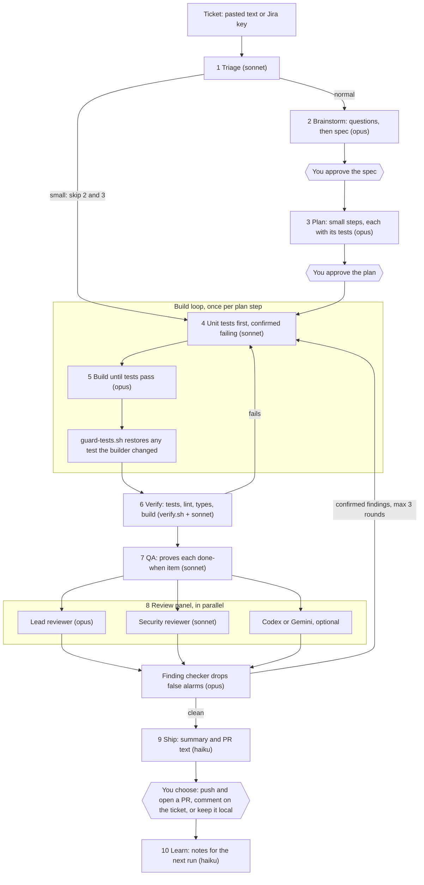

# Software Factory

A Claude Code plugin that takes one ticket to a tested, reviewed git branch. You approve
the spec, the plan, and what gets pushed. Everything in between runs by itself.

Works in any project and any language: a one-time setup reads the repo and saves its
test, lint, type check and build commands.

Read the story behind it: [Software Factory for Claude Code](https://medium.com/@filipdimitrijeski7/software-factory-for-claude-code-79c08ea301e8) on Medium.

```
/factory-setup            # once per project
/factory PROJ-123         # a Jira key, or
/factory "Add CSV export to the reports page"
/factory resume PROJ-123  # pick up a stopped run
```

## How it flows



The hexagons are the only places the factory waits for you.

## The line

| # | Station | Agent | Model | Writes |
|---|---|---|---|---|
| 1 | Intake & triage: sizes the ticket small, normal or too big | `triage` | sonnet | `ticket.md` |
| 2 | Brainstorm: asks you what's unclear, writes the spec | `spec-writer` | opus | `spec.md` |
| | **You approve the spec** | | | |
| 3 | Plan: small steps, each with its unit tests | `planner` | opus | `plan.md` |
| | **You approve the plan** | | | |
| 4 | Write unit tests first, confirm they fail | `test-writer` | sonnet | test files |
| 5 | Write code until the tests pass; can't edit tests | `builder` | opus | code |
| 6 | Verify: tests, lint, type check, build, coverage | `scripts/verify.sh` + `verifier` | sonnet | `test-report.md` |
| 7 | QA: proves each done-when item | `qa` | sonnet | `qa.md` |
| 8 | Review panel, in parallel | `reviewer` · `security-reviewer` · Codex/Gemini | opus · sonnet · other | `review-*.md` |
| | Findings re-checked, false alarms dropped | `finding-checker` | opus | `review.md` |
| 9 | Ship: summary and pull request text | `shipper` | haiku | `summary.md` |
| | **You choose: push and open a PR, comment on the ticket, or keep it local** | | | |
| 10 | Learn: what the next run should know | `learner` | haiku | `.factory/lessons.md` |

Steps 4-8 are the build loop. If verify, QA or review finds a problem, the work goes back
to step 4 with the findings. After 3 rounds (`limits.max_fix_rounds`) the factory stops
and asks you. Small tickets skip steps 2 and 3.

## How it keeps the work honest

- **Tests come first, from a different agent.** The test writer writes failing tests from
  the spec; the builder makes them pass. After each build step,
  `scripts/guard-tests.sh` restores any test file the builder changed. If the builder
  thinks a test is wrong, it has to say so, and you decide.
- **Fresh reviewers.** Reviewers never saw the conversation that wrote the code. An
  optional second opinion comes from another company's model (OpenAI Codex or Google
  Gemini) if its command-line tool is installed.
- **Findings are verified.** The finding checker confirms each one against the code
  before the builder spends time on it.
- **Nothing leaves your machine without asking.** The factory commits only on its own
  branch (`factory/<run-id>`). It pushes, opens pull requests, and comments on tickets
  only after you say yes in that run.

## Requirements

- [Claude Code](https://claude.com/claude-code)
- git and bash (macOS or Linux)
- Optional:
  - [GitHub CLI](https://cli.github.com) (`gh`) to push and open pull requests
  - the Codex or Gemini command-line tool for the second-opinion review
  - the Atlassian connector in Claude for Jira tickets

## Install

Clone it into your Claude skills folder so Claude Code loads it in every project:

```bash
git clone https://github.com/DimitrijeskiF/software-factory.git ~/.claude/skills/software-factory
```

It loads as `software-factory@skills-dir`. In a session that's already open, run
`/reload-plugins`.

To try it for one session without installing:

```bash
claude --plugin-dir /path/to/software-factory
```

Turn it off with `claude plugin disable software-factory@skills-dir`.

## Files in your project

```
.factory/
├─ config.yml      commands, test patterns, models, limits   (commit this)
├─ lessons.md      what the factory learned in this project   (commit this)
└─ PROJ-123/       one folder per run                         (git-ignored)
   ├─ state.md     where the run is, for resume
   ├─ ticket.md  spec.md  plan.md
   ├─ test-report.md  logs/
   ├─ qa.md
   ├─ review-lead.md  review-security.md  review-external.md  review.md
   ├─ fixes-round-1.md
   └─ summary.md
```

## Config

`/factory-setup` writes `.factory/config.yml`; edit it by hand any time. The template,
with every setting, is `skills/factory-setup/config-template.yml`. You can change:

- `commands`: what verify runs. Leave one empty to skip it.
- `tests.patterns`: which files count as tests for the guard.
- `models`: the model for each station (`sonnet`, `opus`, `haiku` or `fable`).
- `review.external`: `auto`, `codex`, `gemini` or `off`.
- `limits.max_fix_rounds` and `limits.command_timeout_sec`.
- `git.branch_prefix`.

**Private code:** with `review.external: auto`, the diff and spec are sent to OpenAI or
Google if their tool is installed. Set it to `off` for projects that must stay private.

## Jira

If the Atlassian connector is available in your Claude session, `/factory PROJ-123`
fetches the ticket, and at the end it can post the summary as a comment once you say yes.
Without it, paste the ticket text instead.

## Tests

The scripts have their own tests. They build throwaway git repos in a temp folder:

```bash
tests/run-tests.sh
```

## Layout

```
.claude-plugin/plugin.json
skills/factory/SKILL.md              the foreman: runs the line, gates, fix loop
skills/factory/references/formats.md the format of every run file
skills/factory-setup/SKILL.md        /factory-setup
skills/factory-setup/config-template.yml
agents/*.md                          one agent per station, each with its default model
scripts/verify.sh                    runs the configured checks, writes test-report.md
scripts/guard-tests.sh               restores test files the builder changed
scripts/external-review.sh           optional Codex / Gemini second opinion
scripts/lib.sh                       config reader and timeout helper
tests/run-tests.sh                   tests for the scripts
```
